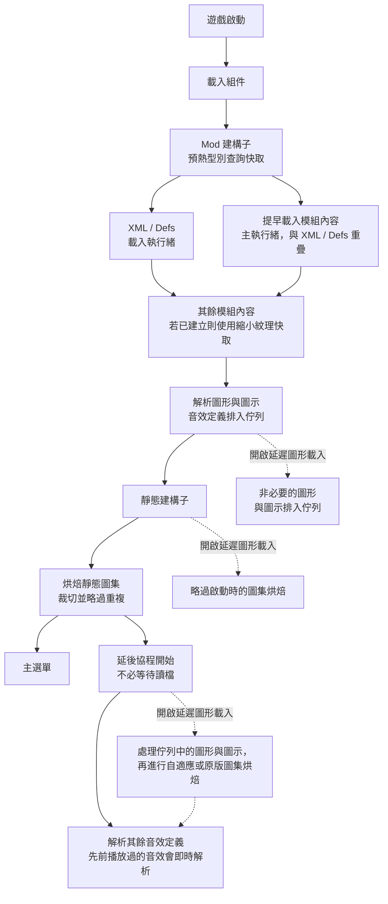

# Faster Game Loading - Continued（RimWorld 1.6）

[](http://rimworldgame.com/)
[](../LICENSE)


本頁說明 **RimWorld 1.6** 版。RimWorld 1.7 請見 [1.7 README](../1.7/README.zh-TW.md)；安裝方式與總覽請見[主 README](../README.zh-TW.md)。

[English](README.md) | 繁體中文

## 啟動流程



使用預設設定時，模組內容、圖形、圖示與靜態圖集都會在主選單出現前準備好，只有音效定義在主選單出現後才完成。延後協程由啟動回呼啟動，因此會在顯示主選單時執行，不必等到讀取存檔。縮小紋理快取需用 **縮小紋理** 工具手動建立，之後的啟動才會使用。

## 功能

預設開啟：

- **提早載入模組內容**：在 RimWorld 正常的 `ReloadContentInt` 輪到各模組之前，利用載入過程中的空檔處理待載入的模組內容。它要等所有 Mod 建構子都執行完（在 `LoadModXML` 時）才開始，因此 FGL 與其他模組的 Harmony 補丁都已套用到提早載入的內容。`PlayDataLoader.Loaded` 為 true 後就停止，切換語言時也不會重新啟動。每幀的時間預算是在模組之間檢查，所以單一大型模組仍可能佔用較長的一幀。啟用 Graphics Settings+ 或 Image Opt 時不預載紋理位元組；主執行緒已讀過的位元組不會再次預取。
- **多執行緒預載入**：平行載入 XML 資源，同時保留 RimWorld 原本的載入資料夾覆寫順序。搭配 Hyperdrive 時，`Defs/` 的 XML 載入交給 Hyperdrive。另有一條背景執行緒依模組載入順序把原始紋理檔讀進記憶體，同一時間最多保留 256 MB，讓主執行緒載入紋理時不必等待磁碟讀取。主執行緒略過的檔案會被釋放，其餘的在啟動結束時釋放。由 Graphics Settings+ 或 Image Opt 載入紋理時不執行這項預讀。
- **型別查詢快取**：在解析 XML 前預熱完整型別名稱，並跨遊戲階段記住已解析的名稱。它遵循 RimWorld 的組件搜尋順序；只有大小寫不同的完整名稱交給 RimWorld 自己不分大小寫的查詢，確保選到同一個型別。模組清單或任何遊戲／模組組件變更時會重新整理，過期的項目則退回 RimWorld 原本的查詢。Harmony 的 `AccessTools.TypeByName` 另有每個遊戲階段的快取。每個組件的型別只列舉一次，並與 `AccessTools.AllTypes` 快取共用；新增組件或動態組件定義了新型別時，該快取會重建。變更後需重新啟動遊戲才生效。
- **裁切靜態圖集**：RimWorld 會把每張靜態圖集的高度補到 2 的次方，第一次放不下時再加倍，所以大型圖集常有一半是空白列。每張圖集為每一層 mipmap 保留一列空白，高度向上取整，讓每一層 mipmap 都是 8 像素的倍數以利 GPU 壓縮。每張紋理的像素位置不變。適用於 RimWorld 原本的烘焙與 **自適應圖集烘焙**。變更後需重新啟動遊戲才生效。
- **略過重複的圖集紋理**：RimWorld 會把可搬運建築的紋理同時排入 Building、Item 與 Misc 三組圖集。當紋理也排入了 Building，且它在所有排入群組中的遮罩狀態一致時，略過 Item 與 Misc 的副本。遮罩狀態互相衝突的副本會保留，避免跨群組查詢時選到錯誤的遮罩。RimWorld 的「found in another atlas group」警告只對被移除的副本靜音。變更後需重新啟動遊戲才生效。

一律開啟（沒有設定項）：

- **延後解析音效**：RimWorld 的音效定義（`SubSoundDef`）解析會排入佇列，在主選單出現後由延後協程完成，即使 **延遲圖形和圖示載入** 關閉也一樣。音效定義尚未解析前就被要求播放的音效（例如主選單的滑過或點擊）會當場解析再播放，所以主選單的介面音效一開始就能使用；介面音效每個遠低於 1 毫秒，而含長音檔的音效（例如 Anomaly 的環境音）最多約 200 毫秒；原版也會在主選單前花同樣的時間。在主執行緒以外發出的請求，或音效定義尚未排入佇列（例如切換語言重新載入期間）的請求，會照舊略過。開啟 **延遲圖形和圖示載入** 時，其餘音效會在延後的圖形、圖示與圖集烘焙之後解析。進入世界時，剩下的音效會立即解析。

預設關閉：

- **延遲圖形和圖示載入**：把部分非必要的圖形與圖示工作移到啟動回呼之後分批處理；它在顯示主選單時就開始，不必等待讀取存檔。家具等必要類別會在 Def 參照解析後才決定。RimWorld 的 `ResolveIcon` 會在延後的圖集烘焙之前處理圖示。變更後需重新啟動遊戲才生效。
- **自適應圖集烘焙**：只有搭配 **延遲圖形和圖示載入** 時才生效。延後的靜態圖集在顯示主選單時烘焙，每幀連續烘焙多張，直到用完該幀的時間預算（主選單 50 毫秒、遊戲中 8 毫秒）。每一批的目標像素量依量測到的 GPU 速度決定，至少相當於 1024×1024 像素，讓繪製仍能受益於批次；每組的最後一批可能較小，只有一張紋理的批次直接使用該紋理，所以個別圖集可能小於 1024×1024。預算在每張圖集烘焙後才檢查，不是硬上限：單一大型圖集仍可能在一幀內花較久。烘焙進行中其他模組排入的紋理也會一併烘焙。沒有開啟延遲載入時，使用 RimWorld 原本的烘焙。已知有風險的種族／多遮罩紋理不會放進靜態圖集。變更後需重新啟動遊戲才生效。
- **較快的圖集壓縮**：在 CPU 路徑上，以 `Texture2D.Compress(highQuality: false)` 取代 `true` 壓縮烘焙好的靜態圖集。高品質模式會加入抖色，耗時較久。GPU 壓縮不受影響。變更後需重新啟動遊戲才生效。
- **啟用詳細日誌**：輸出除錯訊息。若遊戲啟動時就已開啟，第一次啟動後還會記錄主選單出現後，延後的視覺內容與全部延後工作各自多久後完成（主選單前就完成的工作記為 +0.0 s），例如 `[FasterGameLoading] Startup timing after the main menu appeared: visuals ready +0.6 s, all deferred work done +3.0 s.` 不包含到主選單為止的載入時間；[Loading Progress](https://steamcommunity.com/sharedfiles/filedetails/?id=3535481557) 等模組會顯示這段時間。遊戲不經主選單直接進入地圖時不會記錄，切換語言也不會再記錄一次。

手動工具：

- **縮小紋理**：顯示載入畫面，把高解析度紋理縮小後存進獨立的快取（分多次減半以避免鋸齒）。原始模組檔案永遠不會被修改，快取的紋理沿用 RimWorld 的過濾與壓縮流程。`/UI/` 下的紋理保持不產生 mipmap。原始檔的讀取，以及快取 PNG 的編碼與寫入都在背景執行緒進行；只有解碼與 GPU 縮放在主執行緒執行。模組清單變更時，仍在使用中的模組的快取項目會保留。重建時要等每個新檔案都就位才取代舊快取；任何快取檔寫入失敗，或完全沒有寫入任何檔案時，保留舊快取。如果已經在用 Graphics Settings+ 或 RimSort Optimize Texture，通常不需要這項工具。由 Graphics Settings+ 或 Image Opt 載入紋理時無法使用此工具，按鈕也會隱藏。
- **清除紋理快取**：顯示載入畫面並移除已快取的縮小紋理，下次啟動改用原始紋理。

> [!NOTE]
> 啟動時短暫沒有回應可能是正常的，模組清單越大越明顯。尚未解析的音效定義會在第一次播放時解析，所以主選單不會沒有聲音。
> **延遲圖形和圖示載入** 是進階選項。如果遇到紋理或圖示的時序問題，請先關閉它。
> 縮小紋理快取可以在模組設定中清除。
> 翻譯提供英文、簡體中文、繁體中文與俄文。其他語言以及翻譯中缺少的鍵，會透過 RimWorld 自己的翻譯查詢退回英文，因此開啟開發者模式時會顯示 RimWorld 的偽翻譯（帶重音符號的）英文，也就是它標示未翻譯文字的方式。

## 時間省在哪裡

只有型別查詢快取降低了漸近成本。其他功能做的總工作量和原版相同，只是分散到多個核心、讓兩種工作同時進行、縮小輸入，或把工作移到主選單之後。

符號：`T` = 所有已載入組件中的型別數，`U` = 一個遊戲階段中解析的不同型別名稱數，`K` = RimWorld 忽略的命名空間前綴數，`W` = XML 解析的總工作量，`p` = min(CPU 核心數, 8)，`P` = 靜態圖集的像素數。

| 功能 | 原版 | Faster Game Loading | 節省方式 |
| --- | --- | --- | --- |
| 型別查詢快取 | `O(U·(K+1)·T)`：每次未命中都要以不分大小寫的方式詢問每個組件，Mono 會逐一掃描型別表來回答，接著再對每個命名空間前綴重試；每次啟動都重複 | `O(T + U)`：啟動時建立一張完整名稱的雜湊表，之後每個名稱只做一次雜湊查詢；上次遊戲階段的短名稱對應可省去前綴重試 | 漸近 |
| 多執行緒預載入 | 經過時間約 `W / 2`：每個模組 2 條執行緒，模組依序處理 | 經過時間約 `W / p`，下限為最大的單一檔案 | 常數倍，最多約 4 倍 |
| 提早載入模組內容 | `T_XML + T_content` | 重疊部分約為 `max(T_XML, T_content)` | 重疊 |
| 紋理檔預讀 | 主執行緒上 `Σ(讀取 + 解碼)` | 約 `max(Σ 讀取, Σ 解碼)`，最多預讀 256 MB | 重疊 |
| 裁切靜態圖集 | `O(P)`，高度補到 2 的次方 | `O(P′)`，最多移除約一半的列 | 縮小輸入 |
| 略過重複的圖集紋理 | 可搬運建築的紋理最多烘焙 3 次 | 只在 Building 烘焙一次 | 縮小輸入 |
| 縮小紋理（手動） | 以原尺寸解碼並上傳 | 每次減半只剩 1/4 的像素 | 縮小輸入 |
| 延後音效、延遲圖形與圖集烘焙 | 在主選單前完成 | 同樣的工作，在主選單出現後完成 | 移出到主選單的路徑 |

這些界限說明節省從哪裡來，但無法預測秒數；秒數取決於特定模組清單的 `T`、`U`、`W` 與 `P` 有多大。RimWorld 在同一遊戲階段內已會快取解析過的型別名稱，並透過區分大小寫的字典解析被忽略命名空間的短名稱，所以只有兩者都未命中的查詢才會走到慢速路徑。延後的工作仍須完成；要量測總啟動時間，請把 **啟用詳細日誌** 記錄的 `Startup timing after the main menu appeared` 加上到達主選單所花的時間。

## 相容性

以下模組有相容處理：

- [Loading Progress](https://github.com/ilyvion/LoadingProgress)
- [Graphics Settings+](https://github.com/RealTelefonmast/GraphicsSetter)
- [HugsLib](https://github.com/UnlimitedHugs/RimworldHugsLib)
- [AyaTweaks](https://gitlab.com/WRelicK/AyaTweaks2.0) / Ayameduki 系列模組
- [Humanoid Alien Races](https://github.com/erdelf/AlienRaces)
- [Ancot Library](https://steamcommunity.com/sharedfiles/filedetails/?id=2988801276)
- [ChezhouLib](https://steamcommunity.com/sharedfiles/filedetails/?id=3595247479)
- [Hyperdrive](https://github.com/vopaga/rimworld-hyperdrive)

重要行為：

- 搭配 [Hyperdrive](https://github.com/vopaga/rimworld-hyperdrive) 時，Faster Game Loading 把 `Defs/` 的平行 XML 載入交給以模組為單位平行載入的 Hyperdrive，並仍在每個模組內平行處理 `Patches/` 的 XML。若其他模組已先補丁 `LoadModXML`，Hyperdrive 會關閉自己的平行模組載入。RimWorld 不會依載入順序建構 Mod 類別，所以 Faster Game Loading 會等 Hyperdrive 建構完成後才補丁 `LoadModXML`，任何載入順序都適用。如果 Hyperdrive 仍關閉了平行載入，Faster Game Loading 會自己繼續平行解析 `Defs/`。

- [Missile Girl - Performance Mod](https://github.com/ViralReaction/MissileGirl) 與 [DefLoadCache](https://github.com/FluxxField/rimworld-defload-cache) 在本模組中沒有專屬的相容程式碼。預期可與 Faster Game Loading 一起使用，但 Missile Girl 與 DefLoadCache 請擇一，不要同時使用。
- [Image Opt](https://steamcommunity.com/sharedfiles/filedetails/?id=3543873568) 的相容性已不再維護。同時啟用 Faster Game Loading 與 Image Opt 時，依賴 [Ancot Library](https://steamcommunity.com/sharedfiles/filedetails/?id=2988801276) 的模組在某些載入情況下可能出現圖形載入錯誤、紋理遺失或黑色紋理。不建議兩者同時使用，請改用 [Image Opt fork](https://steamcommunity.com/sharedfiles/filedetails/?id=3781013698)。
- 既有的 Image Opt 防護措施（例如略過縮小紋理、清理無效的 `.dds` / `.dds.zstd` 快取）不保證相容。
- [Image Opt fork](https://steamcommunity.com/sharedfiles/filedetails/?id=3781013698) 是 Image Opt 的替代品，作者已為相容 Faster Game Loading 做了修改。請把它放在 Faster Game Loading 之後載入。
- [Humanoid Alien Races](https://github.com/erdelf/AlienRaces) 會在每個種族自己的紋理載入後立即統計該種族的紋理變體。Faster Game Loading 會把這次統計延到所有模組內容載入完成後，避免漏掉之後才載入的種族模組的變體。有了這項處理，HAR 與依賴它的種族模組也能像其他模組一樣提早載入並平行解析 XML。若找不到或無法補丁這個掛鉤，它們會再次被排除在這兩項功能之外。
- HAR（包括其開發版）與 Ancot 相關的種族模組不會被縮小紋理，也不參與 **自適應圖集烘焙**，以減少 bodyAddon、頭髮、耳朵與多遮罩紋理的問題。[Pumpkin Library](https://steamcommunity.com/sharedfiles/filedetails/?id=3790461769) 在 `TextureOverrideSettings.xml` 中列出、用來取代這些模組紋理的 DDS 紋理包也同樣處理。AyaTweaks 與 Ayameduki 系列模組不提早載入，也不平行解析 XML。
- 搭配 [ChezhouLib](https://steamcommunity.com/sharedfiles/filedetails/?id=3595247479) 時，Faster Game Loading 防止重複載入同一組 asset bundle 的防護會在 ChezhouLib 的 asset bundle 載入器之前執行。
- 在靜態建構子改寫 `GraphicData` 或 `Def.graphic` 的模組（例如 [Bionic Icons](https://steamcommunity.com/sharedfiles/filedetails/?id=1677616980)）可搭配 **延遲圖形和圖示載入** 使用：排入佇列後才被改寫的圖形仍會建立，但不會插入靜態圖集，與原版一致，也避免 RimWorld 的「同一張貼圖搭配兩個不同遮罩」圖集錯誤。改寫是透過 `texPath`、`maskPath`、`graphicClass`、`shaderType` 與 `Def.graphic` 判斷；只以反射替換私有 `cachedGraphic`、其餘欄位不動的模組不在涵蓋範圍。

## 建議設定

大多數玩家從預設設定開始即可。

如果載入仍然很慢：

1. 保持 **提早載入模組內容**、**多執行緒預載入** 與 **型別查詢快取** 開啟。
2. 紋理量大的大型模組清單，建議優先使用 Graphics Settings+ 或 RimSort Optimize Texture。Image Opt 的相容性已不再維護，請改用 [Image Opt fork](https://steamcommunity.com/sharedfiles/filedetails/?id=3781013698)。
3. 如果沒有使用外部紋理工具，可考慮 FGL 的 **縮小紋理** 工具。
4. 只有願意自行排除相容性問題時，才開啟 **延遲圖形和圖示載入** 或 **自適應圖集烘焙**。

## 從原始碼建置

1.6 的原始碼位於 `1.6/Source/`，建置後的 DLL 輸出到 `1.6/Assemblies/`。功能依資料夾分組，例如 `Core/`、`Settings/`、`XMLLoadingCache/`、`EarlyModContentLoading/`、`TextureDownscaler/`、`AdaptiveAtlasBaking/`、`StaticAtlasOptimizations/`、`DelayGraphicAndIconLoading/`、`DelaySoundLoading/`、`Compatibility/`、`Language/` 與 `Utilities/`，NUnit 測試位於 `FasterGameLoading.Tests/`。

1.6 版以 .NET Framework 4.7.2 為目標，並透過 [Krafs.Rimworld.Ref](https://www.nuget.org/packages/Krafs.Rimworld.Ref) NuGet 套件參考 RimWorld，所以編譯時不需要本機安裝 RimWorld 1.6。請在儲存庫根目錄執行：

```bash
dotnet build 1.6/Source/FasterGameLoading.csproj -c Release
```

測試使用 .NET 9 上的 NUnit，改以 Microsoft.Testing.Platform 執行：

```bash
dotnet test --project 1.6/Source/FasterGameLoading.Tests/FasterGameLoading.Tests.csproj
```

`global.json` 會啟用 Microsoft.Testing.Platform 的 `dotnet test` 體驗。請在儲存庫根目錄執行上述指令；.NET 10 SDK 必須使用 `--project` 指定專案。這個平台會先執行測試組件的進入點再進行探索，`TestSetup` 才能在探索前註冊組件解析器，於執行期載入遊戲的 `Assembly-CSharp.dll` 與 `UnityStubs.dll`。VSTest 路徑則是在任何測試程式碼執行前就直接反射測試組件，找不到測試並回報「NUnit couldn't find any tests」。1.6 的測試在執行期需要 RimWorld 1.6 真正的 managed 組件：`Krafs.Rimworld.Ref` 是編譯期參考套件，其組件不含方法內容，無法代替遊戲本身。`TestSetup` 會從遊戲安裝目錄的 `RimWorldWin64_Data\Managed` 載入，也可設定 `RIMWORLD_MANAGED_DIR` 覆寫該位置。RimWorld 1.6 與 1.7 共用同一個 Steam 安裝目錄，兩者無法同時存在，因此 1.6 的測試需要遊戲停留在 1.6，1.7 的測試則需要停留在 1.7。組件解析器會比對 `Assembly-CSharp.dll` 的版本，拒絕載入另一個 RimWorld 版本的組件，測試不會在錯誤的遊戲版本上靜默通過。
